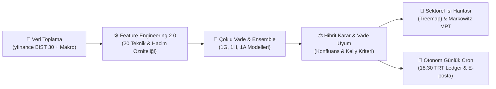

<div align="center">

# 📈 BIST Trend Forecaster
### Borsa İstanbul (BIST 30) Yapay Zeka Tabanlı Yön Tahmin & Portföy Karar Destek Platformu

[](https://github.com/themuhammedguler/BIST-Trend-Forecaster/actions)
[](https://github.com/themuhammedguler/BIST-Trend-Forecaster)
[](https://python.org)
[](https://docs.astral.sh/ruff/)
[](LICENSE)

<br/>

[🚀 Canlı Streamlit Uygulaması](https://bist-trend-forecaster.streamlit.app/) • [🤗 Hugging Face Space](https://huggingface.co/spaces/themuhammedguler/BIST-Trend-Forecaster) • [📊 Deney ve Kıyaslama Raporu](docs/experiments/model_benchmark_report.md)

</div>

---

## 🌟 Proje Genel Bakışı

**BIST Trend Forecaster**, Borsa İstanbul (BIST 30) endeksindeki hisse senetlerinin bir sonraki işlem günündeki yönünü (**Yükseliş / Düşüş**) tahmin etmek ve yatırımcılara matematiksel karar desteği sunmak amacıyla geliştirilmiş uçtan uca kurumsal bir makine öğrenimi (MLOps) platformudur.

Platform; teknik analiz gürültüsünü filtreleyen **çoklu model topluluğu (Ensemble Engine)**, **Modern Portföy Teorisi (Markowitz MPT)**, **Hibrit Karar Motoru** ve insan müdahalesine gerek duymayan **otonom seans kapanış robotu** ile desteklenmiştir.

### 🖥️ Canlı Demo ve Erişim

| Platform | Durum | Canlı Bağlantı |
| :--- | :---: | :--- |
| **Streamlit Cloud** | 🟢 Yayında | [](https://bist-trend-forecaster.streamlit.app/) |
| **Hugging Face Spaces** | 🟢 Yayında | [](https://huggingface.co/spaces/themuhammedguler/BIST-Trend-Forecaster) |

---

## 🚀 Öne Çıkan Temel Yetenekler



### 1. 🎯 Çoklu Vade Trend Matrisi (1 Gün • 1 Hafta • 1 Ay) & Konfluans Uyum Skoru
* **Gürültüden Arındırılmış Çoklu Zaman Pencereleri:** Yalnızca yarınki seans değil ($T+1$), **1 Haftalık ($T+5$)** ve **1 Aylık ($T+20$)** bağımsız makine öğrenimi modelleri ile swing dalga ve ana makro trend tahminleri üretilir.
* **Vade Konfluansı & Uyum Teşhisi:** Farklı vadelerin yön uyumu analiz edilerek `GÜÇLÜ BOĞA`, `DİP ALIM FIRSATI (SAĞLIKLI DÜZELTME)`, `BOĞA TUZAĞI (RİSKLİ TEPKİ)` veya `GÜÇLÜ AYI` gibi kurumsal teşhisler sunulur.
* **%95 Güven Fiyat Koridoru (VaR):** Tarihsel volatilite baz alınarak 1G, 1H ve 1A için beklenen asgari ve azami fiyat aralıkları hesaplanır.

### 2. 📐 Profesyonel Finansal Göstergeler & Risk Masası
* **ADX (Average Directional Index):** Trendin gerçek bir yöne mi sahip olduğunu yoksa testere (yatay) piyasada mı olunduğunu ($ADX > 25$ trend var) tespit eder.
* **Golden Cross / Death Cross Teyidi:** 50 ve 200 günlük hareketli ortalamaların orta/uzun vadeli trend yönünü denetler.
* **Klasik & Fibonacci Pivot Seviyeleri:** Direnç ($R_1, R_2, R_3$), Destek ($S_1, S_2, S_3$) ve Fibonacci (%38.2, %50, %61.8) kritik fiyat seviyeleri.
* **Risk / Ödül Oranı (R:R):** Hedef kar potansiyeli ile göz alınan stop-loss riski oranlanır ($R:R \ge 1.5$ cazip fırsat filtresi).

### 3. 🧠 Çoklu Model & Topluluk Tahmin Motoru (Ensemble)
* **CatBoost, LightGBM ve XGBoost:** Farklı ağaç mimarileri birleştirilerek finansal serilerdeki aşırı uyum (overfitting) ve varyans düşürülmüştür.
* **Yumuşak Oylama (Soft Voting):** Model olasılıkları ağırlıklandırılarak dengeli ve kararlı sinyaller üretilir.
* **CatBoost Liderliği:** Test setinde **%52.13 doğruluk** ve **0.5327 ROC-AUC** ile en yüksek başarıma ulaşmıştır.

### 4. ⚖️ Hibrit Karar Motoru (Rule-Based + AI)
* Yalnızca makine öğrenimi sinyaline bağlı kalmaz; **BIST 100 ana trendi**, **RSI aşırı alım/satım kuralları** ve **momentum göstergelerini** birleştirir.
* Yatırımcıya 5 kademeli net kanaat üretir:  
  `GÜÇLÜ ALIŞ` • `TEMKİNLİ ALIŞ` • `NÖTR / NAKİTTE KAL` • `TEMKİNLİ SATIŞ` • `GÜÇLÜ SATIŞ`

### 5. 🏛️ Kamusal ve Kurumsal Tasarım Kimliği
* Cumhurbaşkanlığı Dijital Dönüşüm Ofisi Kamu Tasarım Standartları ve Borsa İstanbul kurumsal kimliğine uygun derin karanlık renk paleti:
  - **Derin Obsidyen Siyahı (Gece Modu):** (`#07090E`)
  - **Koyu Kurumsal Panel & Kart Zemin:** (`#0F131D`)
  - **Kurumsal BIST Mavisi:** (`#2563EB`)
  - **Zümrüt Yeşili Yükseliş Vurgusu:** (`#059669`)
  - **Asil BIST Kırmızısı:** (`#DC2626` / `#B91C1C`)
  - **Zarif Panel Sınırları:** (`#1A2233`)

### 6. 🌲 BIST 30 Sektörel Isı Haritası (Treemap)
* Bankacılık, Sanayi, Holding, Havacılık vb. tüm sektörlerin yapay zeka yön eğilimini hiyerarşik interaktif bir ağaç haritasında görselleştirir.
* Hem **Yapay Zeka Yükseliş Olasılığı (%)** hem de **Günlük Fiyat Değişimi (%)** ölçeğinde renklendirilebilir.

### 7. 💼 Modern Portföy Teorisi (Markowitz Maksimum Sharpe Oranı)
* Hisselerin tahmin edilen getirileri ($\boldsymbol{\mu}$) ile 5 yıllık kovaryans matrisini ($\boldsymbol{\Sigma}$) birleştirir.
* `scipy.optimize (SLSQP)` çözücüsüyle risk başına getiriyi maksimize eden optimal ağırlıkları hesaplar.
* Portföy dağılım halka grafiği (donut chart) ve TL bazlı somut alım tutarları sunar.

### 8. 🤖 Otonom Günlük Tahmin & Denetim Defteri (Forward Tracking Ledger)
* **Otomatik Çalışma:** Her iş günü **18:30 TRT (15:30 UTC)** seans kapandığında GitHub Actions cron job'ı devreye girer.
* Dünkü tahminleri gerçekleşen fiyatlarla denetler, yarınki seans için tüm BIST 30 tahminlerini üretip `prediction_audit.json` defterine işler ve repoya otomatik commit eder.
* **440+ Tarihsel Tahmin:** Gerçekleşen 1 günlük, 3 günlük ve 1 haftalık getiriler ve isabet oranları şeffafça takip edilir.

### 9. 🔒 Gizlilik Dostu Ziyaretçi Analitiği (3 Katmanlı Mimari)
* **GoatCounter** entegrasyonu ile KVKK/GDPR uyumlu, çerezsiz ziyaretçi takibi.
* Streamlit iframe sandbox engellerini aşan istemci scripti + görsel beacon + sunucu taraflı Python arka plan pingi (**%100 AdBlock geçirmez**).

### 10. 📰 KAP Haber & Kurumsal RAG Chatbot Entegrasyonu
* Son KAP açıklamaları üzerinde FinBERT/LLM tabanlı duygu analizi.
* [Financial-Analyst-ChatBot-Project](https://github.com/themuhammedguler/Financial-Analyst-ChatBot-Project) ile çift yönlü derin bağlantı ve bilanço incelemesi.

---

## 📊 Model Karşılaştırma Karnesi (Feature Engineering 2.0)

Eğitim ve test setleri, finansal zaman serilerinde veri sızıntısını (look-ahead bias) engellemek amacıyla **tarihsel kesim (`get_temporal_split`)** ile ayrılmıştır (Eğitim: 2018-2025, Test: 2025-2026).

| Model Mimarisi | Test Doğruluğu (Accuracy) | Dengeli Doğruluk | ROC-AUC | Log Loss | Açıklama |
| :--- | :---: | :---: | :---: | :---: | :--- |
| 🥇 **CatBoost** | **%52.13** | **%51.82** | **0.5327** | **0.6899** | En yüksek genelleme başarımı |
| 🥈 **LightGBM** | **%51.83** | **%51.41** | **0.5285** | **0.6904** | Hızlı ve dengeli ağaç yapısı |
| 🥉 **Topluluk (Ensemble)** | **%51.58** | **%51.23** | **0.5281** | **0.6902** | Düşük varyanslı yumuşak oylama |
| ⚙️ **XGBoost** | **%50.75** | **%50.39** | **0.5160** | **0.6912** | Sağlam temel referans model |

> 📌 **Finansal Piyasalarda %52 Doğruluğun Anlamı:** Günlük hisse yön tahminlerinde %50 rastgele yazı-tura seviyesidir. İşlem maliyetleri ve fraksiyonel Kelly kriteri ile birleştiğinde %52+ out-of-sample başarı, istatistiksel ve pozitif beklenen getiri (edge) sunar.

---

## 🛠️ Feature Engineering 2.0 (20 Öznitelik)

Modelimiz aşağıdaki 20 matematiksel gösterge üzerinden beslenmektedir:

| Kategori | Göstergeler | Açıklama |
| :--- | :--- | :--- |
| **Momentum & Salınım** | `rsi`, `stoch_k`, `williams_r`, `roc_5` | Aşırı alım/satım, momentum ivmesi ve döngüsel salınımlar |
| **Hacim & Para Akışı** | `mfi`, `vol_ratio`, `vol_change` | Para Akışı Endeksi (MFI) ve 20 günlük hacim patlama oranı |
| **Trend & Ortalamalar** | `macd`, `sma_10_ratio`, `sma_50_ratio` | MACD farkı ve 10/50 günlük hareketli ortalamalardan sapma |
| **Volatilite & Risk** | `atr_ratio`, `bb_width`, `volatility` | Normalize Average True Range, Bollinger bant genişliği |
| **Gecikmeli Getiriler** | `lag_1_ret`, `lag_2_ret` | Dünkü ve önceki günün yüzdesel getirileri |
| **Makro & Göreceli Güç**| `xu100_ret`, `rel_strength_bist`, `usdtry_change` | BIST 100 endeks getirisi, hissenin endekse göre rölatif gücü ve kur |
| **Takvim Döngüleri** | `day_of_week`, `month` | Haftanın günü ve ay mevsimselliği |

---

## 💻 Kurulum ve Yerel Çalıştırma

### 1. Yerel Ortam (Python venv)

```bash
# Depoyu klonlayın
git clone https://github.com/themuhammedguler/BIST-Trend-Forecaster.git
cd BIST-Trend-Forecaster

# Sanal ortam oluşturun ve aktifleştirin
python -m venv venv
# Windows:
.\venv\Scripts\activate
# Linux/macOS:
source venv/bin/activate

# Bağımlılıkları yükleyin
pip install -r requirements.txt

# Uygulamayı başlatın
streamlit run app.py
```

### 2. Docker & Docker Compose ile Çalıştırma

```bash
# Konteyneri derleyin ve ayağa kaldırın
docker compose up --build
```
Uygulama doğrudan `http://localhost:8501` adresinde yayına başlayacaktır.

---

## 🧪 Testler ve Kod Kalitesi

Projede regresyonları önlemek için **357 birim ve entegrasyon testi** bulunmaktadır:

```bash
# Geliştirme bağımlılıklarını kurun
pip install -r requirements-dev.txt

# Tüm test paketini çalıştırın
pytest -q

# Linter ve biçimlendirme kontrolleri
ruff check .
ruff format . --check
```

---

## 📁 Proje Dizin Yapısı

```text
BIST-TREND-FORECASTER/
├── .github/workflows/         # CI/CD, haftalık yeniden eğitim ve günlük cron
│   ├── ci.yml                 # Test & lint doğrulama iş akışı
│   ├── daily_forecast.yml     # 18:30 TRT otonom günlük tahmin cron'u
│   └── retrain.yml            # Haftalık model yeniden eğitim iş akışı
├── assets/                    # Logo ve görsel materyaller
├── data/
│   ├── bist30_combined.csv    # 5 yıllık BIST 30 seans ve makro veri seti
│   └── prediction_audit.json  # 440+ ileriye dönük tahmin denetim defteri
├── docs/experiments/          # Benchmark ve ampirik deney raporları
├── models/                    # Eğitilmiş CatBoost, LightGBM, XGBoost ve meta dosyaları
├── src/                       # Modüler kaynak kod mimarisi
│   ├── analytics.py           # Gizlilik dostu ziyaretçi analitiği (GoatCounter)
│   ├── backtest.py            # Vektörize strateji simülatörü
│   ├── config.py              # Konfigürasyon ve tekil kaynak listeleri
│   ├── daily_updater.py       # Otonom günlük seans tahmin motoru
│   ├── email_alerts.py        # HTML bülten ve fırsat radarı e-posta modülü
│   ├── ensemble.py            # Çoklu model ve topluluk (Soft Voting) motoru
│   ├── explain.py             # SHAP öznitelik katkıları ve açıklanabilirlik
│   ├── features.py            # Feature Engineering 2.0 (20 teknik öznitelik)
│   ├── fundamental_rag.py     # Bilanço analizi RAG chatbot entegrasyonu
│   ├── hybrid_decision.py     # Kural tabanlı ve yapay zeka hibrit karar motoru
│   ├── kap_llm.py             # LLM tabanlı KAP haber duygu analizi
│   ├── live_data.py           # Canlı seans ve makro veri çekim motoru
│   ├── portfolio_optimizer.py # Markowitz MPT Sharpe & Sektörel Treemap
│   ├── risk_sizing.py         # Kelly Kriteri dinamik pozisyon boyutlandırma
│   ├── scanner.py             # BIST 30 piyasa fırsat radarı
│   └── tracker.py             # İleriye dönük tahmin gerçekleşme defteri
├── tests/                     # 357 birim ve entegrasyon testi
├── app.py                     # Ana Streamlit uygulama arayüzü
├── Dockerfile                 # Konteyner imaj tanımı
├── docker-compose.yml         # Konteyner orkestrasyonu
├── pyproject.toml             # Ruff ve proje meta ayarları
├── requirements.txt           # Üretim bağımlılıkları
└── README.md                  # Proje dokümantasyonu
```

---

## ⚖️ Yasal Uyarı

Bu platformda sunulan tüm yapay zeka yön tahminleri, olasılık hesaplamaları, teknik göstergeler ve portföy optimizasyonu çıktıları **yalnızca karar destek ve eğitim amaçlıdır**. 

Hiçbir şekilde **Yatırım Tavsiyesi Değildir (YTD)**. Finansal piyasalarda işlem yapmak sermaye kaybı riski taşır; kararlarınızı kişisel risk toleransınıza göre alınız.

---

<div align="center">

Geliştirici: **Muhammed Güler**  
[GitHub Profil](https://github.com/themuhammedguler) • [LinkedIn](https://www.linkedin.com/in/themuhammedguler) • [Hugging Face](https://huggingface.co/themuhammedguler)

BIST Trend Forecaster © 2026 · Açık Kaynak Karar Destek Platformu

</div>
